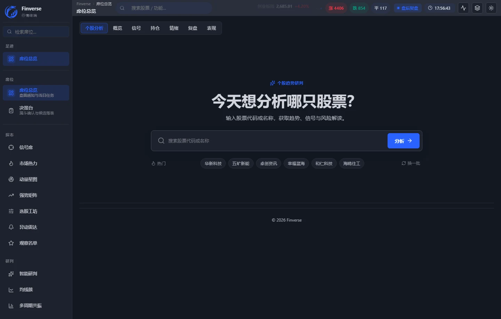
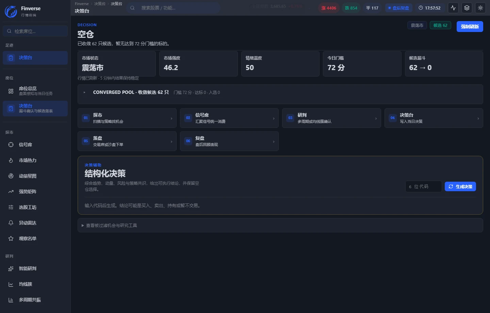
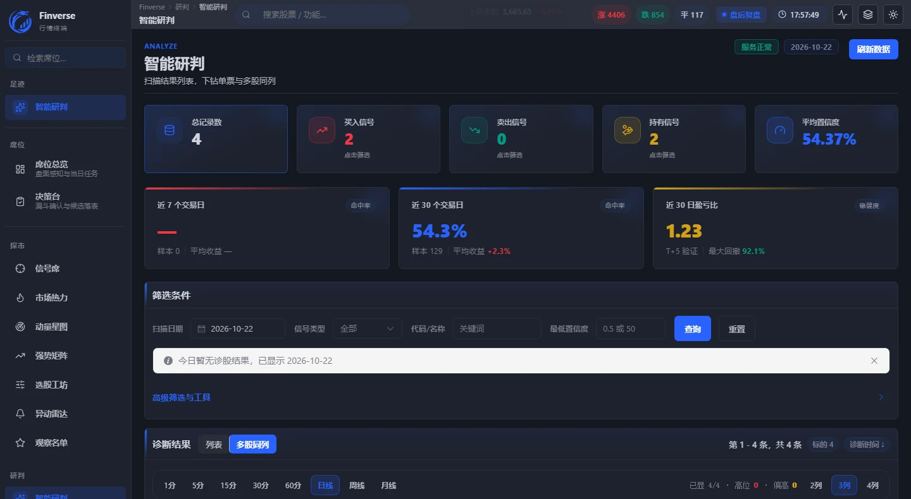

<div align="center">
  
  <h1>Finverse 泛思</h1>
  <p><strong>把研究做在交易之前。</strong></p>
  <p>面向 A 股、港股、美股的智能投资研究工作台。<br>从市场观察、信号扫描到决策记录与复盘，让每一次判断都有迹可循。</p>
  <p>
    <a href="https://mjvii.com"><strong>立即体验 →</strong></a>
    &nbsp;·&nbsp;
    <a href="#产品界面">产品界面</a>
    &nbsp;·&nbsp;
    <a href="#快速开始">本地运行</a>
  </p>
  <p>
    <a href="LICENSE"></a>
    
    
    <a href="https://mjvii.com"></a>
  </p>
</div>

<p align="center">
  <a href="https://mjvii.com">
    
  </a>
</p>

## 为什么是 Finverse

投资研究最难的，往往不是找到一个观点，而是把观点变成一套**可执行、可复核、可复盘**的流程。Finverse 把分散在行情、信号、研究和交易记录里的信息收进同一张工作台：

- **先看环境，再做判断**：市场温度、情绪与强弱关系放在研究流程的起点。
- **先定条件，再找机会**：用明确规则筛选候选标的，减少临场情绪干扰。
- **先留记录，再谈复盘**：每一次决策都有上下文，方便回看结论如何形成。
- **覆盖三地市场**：同一套研究口径贯通 A 股、港股与美股。

> 在线体验只通过官网入口：[**mjvii.com**](https://mjvii.com)

## 产品界面

### 决策台：把流程收束成一个动作

从市场强度、情绪温度到候选漏斗，再到结构化决策，所有信息围绕“今天该不该行动”组织。

| 决策台 | 智能研判 |
|:---:|:---:|
| [](https://mjvii.com) | [](https://mjvii.com) |

### 研究工作台：从一只股票开始

输入代码或名称，进入趋势、信号与风险解读；也可以沿着左侧研究链路，逐步查看市场热力、选股工坊、观察名单与复盘工具。

## 核心能力

| 模块 | 它解决什么问题 |
| --- | --- |
| **研究工作台** | 用统一入口完成个股趋势、信号、持仓与风险解读。 |
| **市场温度** | 将涨跌家数、情绪与板块强弱整理成易读的市场环境快照。 |
| **信号扫描** | 按规则发现值得进一步研究的对象，而不是给出无依据的结论。 |
| **智能研判** | 汇总多周期与多因子信息，把研究过程拆成可检查的证据链。 |
| **决策台** | 将候选漏斗、准入条件和当日动作收束到同一视图。 |
| **复盘记录** | 保留判断依据与结果，持续校准自己的研究体系。 |

## 一套可复核的研究链路

1. **看环境**：市场温度、情绪与风险偏好。
2. **找线索**：信号扫描、异动雷达与观察名单。
3. **做研判**：趋势、量能、多周期与多股同列。
4. **写决策**：把条件、风险与结论放在同一条记录里。
5. **做复盘**：回看逻辑是否成立，而不只看账面结果。

## 快速开始

项目是零依赖静态站点，克隆后即可本地预览：

```bash
git clone https://github.com/cesiv/finverse-homepage.git
cd finverse-homepage
python -m http.server 5173
```

打开 `http://localhost:5173`。如果使用 Node.js，也可以运行：

```bash
npx --yes serve . -l 5173
```

试用表单与首方统计是可选的 PHP 接口；不配置时，静态页面、双语切换、主题和所有产品展示仍可正常使用。

## 可选配置

将示例配置放到站点根目录的上一级，并改名为 `finverse-config.php`：

```bash
cp finverse-config.example.php ../finverse-config.php
```

Windows PowerShell：

```powershell
Copy-Item finverse-config.example.php ..\finverse-config.php
```

然后填写邮件投递与分析哈希所需的值。也可以通过环境变量配置：

| 变量 | 用途 |
| --- | --- |
| `FINVERSE_CONFIG` | 真实配置文件路径 |
| `FINVERSE_RECIPIENT` | 试用申请接收邮箱 |
| `FINVERSE_WEB3FORMS_KEY` | Web3Forms 访问密钥（可选） |
| `FINVERSE_FORMSUBMIT_ID` | FormSubmit 表单 ID（可选） |
| `FINVERSE_ANALYTICS_SALT` | 首方统计的随机哈希盐值 |
| `FINVERSE_TRUST_PROXY` | 仅在可信反向代理后设为 `true` |

生产环境请把表单提交日志、统计日志和真实配置放在 Web 根目录之外，并对个人信息设置合理的保留期限。

## 项目结构

```text
.
├── index.html                   首页与产品叙事
├── market-temperature.html      公开市场温度页
├── weekly-picks.html            公开研究方法页
├── privacy.html                 隐私政策
├── submit.php                  试用申请接收接口
├── track.php                   首方匿名统计接口
├── assets/
│   ├── css/                     视觉、内容页与响应式样式
│   ├── js/                      粒子场景、产品 UI、双语文案、交互
│   ├── data/                    公开页数据
│   ├── fonts/                   本地字体资源
│   └── img/                     图标、二维码与分享封面
├── docs/screenshots/            README 产品界面图
├── finverse-config.example.php  运行时配置示例
└── .htaccess                    HTTPS、缓存与安全响应头
```

## 自定义与部署

- **品牌与文案**：中文文案集中在 `assets/js/i18n.js`，页面结构在 `index.html`。
- **颜色与视觉**：设计变量位于 `assets/css/style.css` 顶部；粒子配色位于 `assets/js/scene.js`。
- **示例产品面板**：导出数据与界面定义位于 `assets/js/mockups.js`。
- **公开页数据**：更新 `assets/data/` 下的数据文件，并同步页面上的数据日期。
- **域名信息**：复刻部署时请同步修改 canonical、Open Graph、`sitemap.xml` 与 `.htaccess` 中的域名。
- **部署方式**：任意静态托管均可；如需试用表单或首方统计，请使用支持 PHP 8.1+ 的环境，并把日志目录放到 Web 根目录之外。

## 参与贡献

欢迎提交 issue 或 pull request。提交前请确认：

- 本地页面在桌面和移动端均可正常浏览；
- 没有提交真实用户数据、密钥、日志或部署凭据；
- 新增内容遵守下面的免责声明，不把示例数据包装成真实业绩。

## 免责声明

本项目中的行情、指标、界面数据与 AI 输出均为产品演示或示例，仅用于研究流程展示，不构成任何投资建议，也不构成任何证券的买卖要约或招揽。历史表现和示例结果不代表未来收益。投资有风险，决策前请独立核验信息并咨询具备资质的专业人士。

MIT License 适用于本项目代码。Finverse 名称、标识、官网视觉与产品截图的相关权利归 Finverse 所有。
